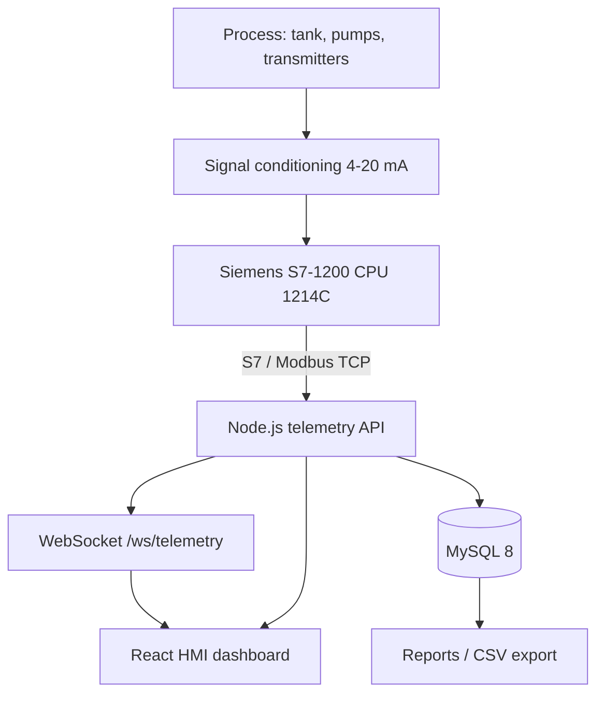

# Architecture and communication

## 1. Overview

## 2. Data flow

1. Field signals are scaled in `FB_AI_Scale` to engineering units.
2. `OB1` calls alarm detection, then pump control and maps the result to DB 10.
3. The API polls DB 10 every `POLL_INTERVAL_MS` (1000 ms default).
4. Samples are stored in MySQL when configured, otherwise in the in-memory repository.
5. The HMI receives the latest snapshot through REST and WebSocket.

## 3. Source abstraction

`backend/src/adapters/` defines two implementations of the same interface:

| Adapter | `PLC_SOURCE` | Use |
| --- | --- | --- |
| `simulator-adapter.js` | `simulator` (default) | Python process model, no hardware needed |
| `s7-adapter.js` | `s7` | `nodes7` client reading/writing DB 10 |

The `s7` adapter requires a real S7-1200 with PUT/GET access enabled or PLCSIM Advanced with a virtual Ethernet adapter. Classic S7-PLCSIM does not expose an ISO-on-TCP endpoint by itself. TIA Portal V19, PLCSIM V19 and PLCSIM Advanced are installed in the development environment; hardware integration was **not** executed.

## 4. Tag database

All HMI-visible data is mapped to a single DB (`DB10`) with the offsets in [io-list.md](io-list.md). This keeps the PLC/API contract small and simplifies simulation.

## 5. Timing

| Task | Period |
| --- | --- |
| OB1 cyclic PLC scan | 100 ms (simulated) |
| API poll | 1000 ms |
| WebSocket broadcast | On every poll |
| MySQL sample retention | 30 days (report cleanup job, future work) |

## 6. Security

- No credentials are committed; use `.env` and `.env.example`.
- The current HMI has no authentication: lab/network use only.
- Add TLS, authentication and write-command whitelisting before production use.

## 7. Nota (ES)

La arquitectura está preparada para crecer a OPC UA o MQTT sin cambiar el contrato de la API: basta agregar un adaptador nuevo con los mismos métodos `readSnapshot()` y `writeTag()`.
