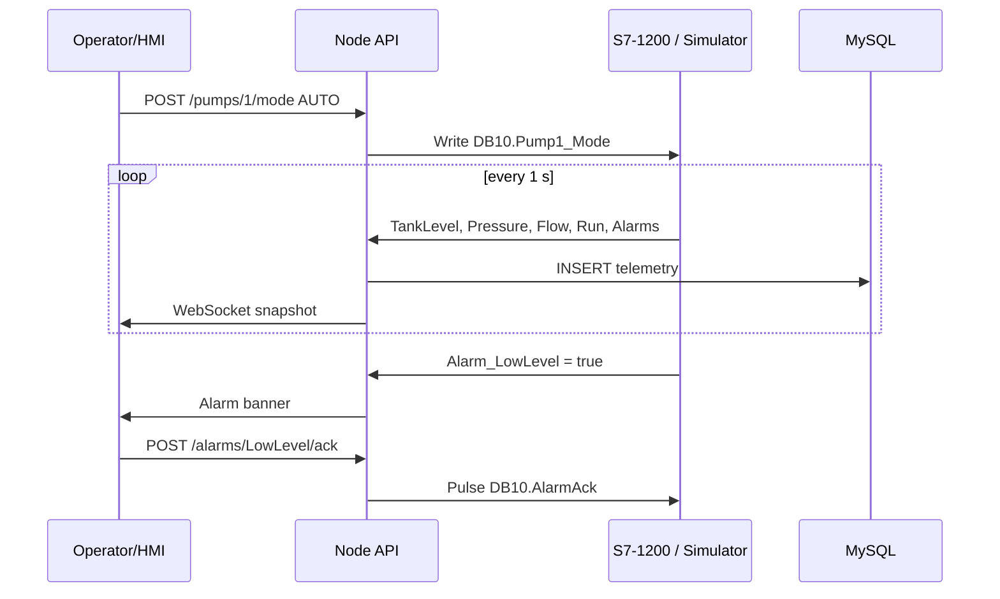

# Control sequence and alarm logic

## 1. Operating states

| State | Condition | Action |
| --- | --- | --- |
| `STOPPED` | No start request, level above start band | Both pumps stopped |
| `LEAD_RUN` | Level < 30 % in AUTO | Lead pump starts |
| `LEAD_LAG_RUN` | Level < 20 % in AUTO | Both pumps start |
| `LAG_STOP` | Level > 75 % | Lag pump stops |
| `ALL_STOP` | Level > 85 % | Both pumps stop |
| `MANUAL` | Pump mode = 0 | HMI command governs that pump |

## 2. Lead/lag alternation

- The pump with lower accumulated runtime becomes lead on the next alternation event.
- Alternation is triggered after `SWAP_INTERVAL_S` (8 h real plant, 600 s simulator) of continuous lead runtime **and** level above 50 %, so switching does not disturb an active demand.
- Runtime counters increment only while the pump run output is true.

## 3. Interlocks

A pump may start only if:

1. Emergency stop is healthy.
2. Its overload input is not tripped.
3. Tank level is above low-low (except manual test with bypass, not implemented).
4. The opposite pump is not in fault (required for lag start).
5. No high-pressure alarm is latched.

## 4. Alarms

| Alarm | Detection | Latch | Ack |
| --- | --- | --- | --- |
| `LowLevel` | Level < 15 % | Yes | `AlarmAck` rising edge |
| `HighPressure` | Pressure > 9.5 bar | Yes | `AlarmAck` rising edge |
| `DryRun` | Run command with level < 5 % | Yes | `AlarmAck` rising edge |
| `Overload` | DI overload = 1 | Yes | `AlarmAck` rising edge |
| `SensorFault` | Raw current < 3.8 mA or > 20.8 mA | Yes | `AlarmAck` rising edge |
| `JammedPump` | Run feedback true and flow < 2 m³/h for 10 s | Yes | `AlarmAck` rising edge |

Acknowledging clears the latch only when the fault condition has disappeared; otherwise the alarm immediately reasserts.

## 5. Sequence diagram

## 6. Nota (ES)

La lógica prioriza la seguridad: paro por nivel bajo y sobrecarga tiene prioridad sobre cualquier Start manual; el reconocimiento de alarmas no oculta una falla activa.
